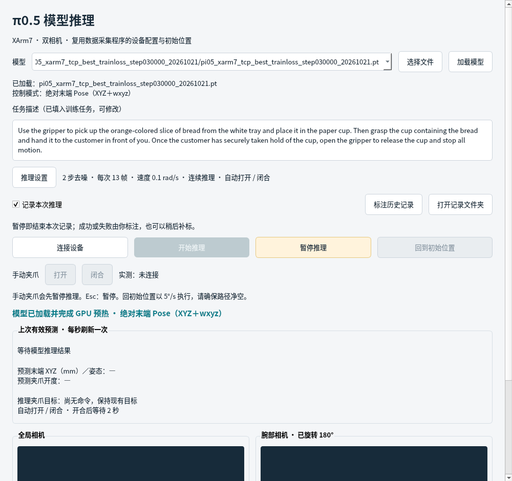

# π0.5 XArm7 模型推理 GUI

这是服务器桌面入口“π0.5 XArm7 推理”对应的独立 GUI 项目。程序支持选择并校验模型、连接 XArm7 与双相机、连续推理、夹爪控制、回到采集初始位姿，以及推理过程记录和结果标注。



## 入口

原服务器桌面文件：`/home/a/桌面/启动π0.5推理.desktop`

它调用 `启动推理.sh`，最终入口为：

```bash
python app.py
```

打开界面和加载模型不会自动连接机械臂。连接设备、开始推理和回初始位姿均需在界面中显式操作。

## 主要能力

- 支持 joint、TCP absolute pose 与 EEFDelta 三类模型契约。
- 模型加载时检查权重大小、SHA-256、训练配置、归一化统计与运行时版本。
- 双相机观测、动作分块执行、速度/加速度约束和硬件状态检查。
- 夹爪开合迟滞控制，暂停后清空未执行动作并重新观测。
- 可选保存推理轨迹、图像、模型契约与结果标注。
- 提供离线适配、控制逻辑、设置执行和 GUI 单元测试。

详细操作、动作定义和安全说明见 [使用说明.txt](使用说明.txt) 与 [生效控制检查清单_20261021.txt](生效控制检查清单_20261021.txt)。

## 环境准备

1. 创建 Linux Python 环境并安装 `requirements-runtime.txt`。
2. 准备与 `runtime_manifest.json` 一致的 LeRobot/RLinf/OpenPI 运行时。
3. 将 PaliGemma tokenizer 放到 `assets/paligemma_tokenizer.model`。该文件和模型权重未进入仓库。
4. 将 `inference_settings.example.json` 复制为 `inference_settings.json`，再按设备调整。
5. 在 `hardware.py` 中确认采集项目目录，或保持原服务器目录 `/home/a/xarm7-vr-lab`。
6. 将模型目录放在 GUI 同级目录，或调整 `app.py` 中的 `MODEL_ROOTS`。

原服务器通过随项目部署的 `vendor` 目录补充 PySide6/JAX 等二进制依赖。为避免提交数百 MB 平台相关二进制，该目录未纳入仓库。

## 启动与测试

```bash
cp inference_settings.example.json inference_settings.json
python app.py
pytest -q test_control.py test_ui.py test_settings_execution.py test_run_results.py test_tcp_adapter.py test_eefdelta_adapter.py
```

测试默认不应操作真实硬件；进行实机运行前，必须关闭遥操/采集后台，核对机械臂身份、工具坐标、世界坐标、相机和安全空间。

## 仓库边界

仓库包含 GUI 源码、硬件适配、模型契约、设置、测试、说明和界面截图。以下内容被明确排除：模型权重、tokenizer、推理记录、相机图像、日志、虚拟环境、缓存和平台相关 `vendor` 二进制。

部分验证 JSON 保留了原服务器绝对路径，用于说明当时验证对象；它们不是可直接复用的本机配置。

